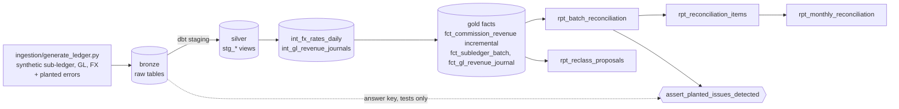

# Revenue-to-GL Reconciliation

[](https://github.com/Saigwe/revenue-gl-reconciliation/actions/workflows/ci.yml)

> An incremental dbt pipeline that ties a marketplace's commission revenue sub-ledger to the general ledger with **$0 unexplained variance**, explains every difference, and proposes reclassification journals, with an answer-key test that proves it catches planted errors.

**Author:** Stanley Igwe, Lead Data (Analytics) Engineer · [Portfolio](https://saigwe.github.io)
**Stack:** Python · dbt Core (incremental models, unit tests, data tests) · DuckDB (local and CI) · Snowflake target (optional) · Dagster (orchestration) · GitHub Actions
**Status:** 🚧 Core pipeline working (`dbt build` 69/69 passing). See [Roadmap](#roadmap).

Based on work I did in accounting analytics at a US food-delivery company, rebuilt end to end on **synthetic data**. No employer data, code or logic is used.

---

## 90-second summary
| | |
|---|---|
| **Problem** | Revenue lives in a high-volume sub-ledger, but auditors sign off the general ledger. Month-end means proving the two agree, explaining every difference, and finding revenue booked to the wrong account. |
| **What I built** | A layered dbt model: FX rates with a fallback rule, an incremental revenue fact, batch-level and month-level reconciliations, a reconciling-items model, and reclassification proposals. |
| **Why it matters** | Finance gets **one tied number per account and month**, a list of exactly what to fix (duplicates, wrong FX, late postings), and reclass journals ready to book, all reproducible for audit. |
| **Proof** | An answer-key test plants errors in the synthetic GL and fails the build unless every one is found with the right reason and amount, **and nothing else is flagged**. See [Numbers](#numbers). |

## Architecture

Orchestration: `orchestration/definitions.py` exposes the generator and every dbt model as Dagster assets. There's a daily schedule, plus a month-end re-tie job for days 1–3 of each month.

## Data model (gold layer)
| Model | Grain | Purpose |
|---|---|---|
| `fct_commission_revenue` | one row per sub-ledger event | local and USD amounts, system vs expected account. **Incremental on `loaded_at`**, with a lookback. |
| `fct_subledger_batch` | one row per posting batch | what the GL should hold: local total, and USD translated at batch level (the GL convention) |
| `fct_gl_revenue_journal` | one row per GL journal on a revenue account | posting date and month, FX rate used, duplicate-posting flag |
| `rpt_batch_reconciliation` | one row per batch | sub-ledger vs GL, variance, `variance_reason` |
| `rpt_reconciliation_items` | batch × account × month × category | the items that explain each monthly variance |
| `rpt_monthly_reconciliation` | account × month | **the audit view**: sub-ledger, GL, variance, timing, duplicates, FX errors, unexplained, corrected GL, status |
| `rpt_reclass_proposals` | month × from-account × to-account | journals that move misclassified revenue to the right account |
| `dim_account`, `dim_merchant` | one row per account / merchant | reference data |

## How differences are explained
`variance_reason` is checked in this order:
1. `missing_in_gl`
2. `missing_in_subledger`
3. `gl_duplicate`
4. `amount_mismatch`
5. `gl_wrong_fx`
6. `gl_late_posting`
7. `tied`

At month level, GL (by posting month) minus sub-ledger (by event month) is split into these items:

| Item | Meaning | Action |
|---|---|---|
| `timing_late_arrival` | events loaded days late and posted in a later month | none: a known cut-off item |
| `timing_late_posting` | a batch posted after its scheduled date, across a month end | investigate the posting delay |
| `gl_duplicate` | the same batch posted twice | reverse the duplicate |
| `gl_wrong_fx` | the GL used a different rate from the reference rate | correct the translation |
| `unexplained_*` | anything else | **fails the build** |

A month is `tied` only when unexplained = 0 **and** the items add up exactly to the variance.

## Data quality: proving it, not asserting it
- **Answer-key test** (`tests/assert_planted_issues_detected.sql`): the generator plants a duplicate journal, a wrong-FX journal, a late month-end posting, and a mapping bug that books enterprise marketing fees to the commission account. The test fails if any planted error is missed, misclassified or wrong by ≥ $0.01, or if any batch or event is flagged that was not planted. A mutation check (raising the tolerance so FX errors hide) makes it fail, as it should.
- **Incremental equals full refresh** (`scripts/check_incremental.py`):
  1. Load only the events landed by a cutoff.
  2. Run incrementally with the rest.
  3. Full-refresh, and compare both results with `EXCEPT` in each direction.
  This catches the classic bug of filtering incremental loads on event time instead of load time.
- **dbt unit tests:**
  - variance-reason priority on hand-written rows
  - weekend events use Friday's FX rate
  - refunds map to the contra-revenue account
- **Business-rule tests:**
  - every GL journal balances (double entry)
  - no account-month has unexplained variance
  - refunds never exceed the commission charged
- **Generic tests:** `unique`, `not_null`, `relationships` and `accepted_values` on every key and status column.

## Numbers
From real runs on a Windows laptop (DuckDB, Python 3.14, dbt 1.11). Regenerate with `make all`.

| Metric | Full run | CI fixture |
|---|---|---|
| Merchants / orders / sub-ledger events | 2,000 / 77,549 / 91,261 | 60 / 3,822 / 4,386 |
| Posting batches / GL journal lines | 2,983 / 5,968 | 789 / 1,580 |
| Synthetic revenue (USD, 6 months) | $663,228 | n/a |
| dbt nodes passing (models, data tests, unit tests) | 69 / 69 | 69 / 69 |
| `dbt build` runtime (as reported by dbt; ~15 s wall clock including start-up) | 3.2 s | ~2.5 s |
| Account-months tied with $0 unexplained | 26 / 26 | 13 / 13 |
| Planted GL errors found / false positives | 3 of 3 / 0 | 3 of 3 / 0 |
| Misclassified events found / proposed reclass | 210 of 210 / $320.82 | 5 of 5 / $6.02 |
| Late-arriving events picked up by the incremental run | 83 (equal to full refresh) | 1 (equal to full refresh) |
| Days on a fallback FX rate (weekends and holidays) | 220 currency-days | n/a |

## How to run
Requires **Python 3.12** (what CI uses) and `make`, or run the commands in the `Makefile` by hand.
```bash
python -m venv .venv && source .venv/bin/activate   # Windows: .venv\Scripts\activate
pip install -r requirements.txt
make all          # 2,000 merchants, Jan–Jun 2025 -> dbt build -> incremental check
make fixture-all  # small ledger, used in CI
```
- **Dagster:** `pip install -r requirements-orchestration.txt`, then `make dagster`. The UI opens on http://localhost:3000.
- **Snowflake:** set the `SNOWFLAKE_*` variables in `dbt/profiles.yml`, load the bronze tables, then run `dbt build --target snowflake`. Date parsing goes through a dispatched macro, so the model SQL stays portable.

*Note:* on Python 3.14, dbt 1.11 needs `pip install -U mashumaro` to start, and Dagster doesn't install yet. Use 3.12.

## Roadmap
- [x] Synthetic ledger with planted errors; staging → intermediate → marts; reconciliation and reclass models; unit, data and answer-key tests; incremental check; fixture-based CI
- [ ] Run the Dagster assets and schedules on Python 3.12, and add a screenshot of the asset graph
- [ ] Monthly partitions in Dagster, so a single month's backfill is one click
- [ ] Snowflake run (trial account) with runtime and credit cost
- [ ] Streamlit "close cockpit": monthly status, drill from account to batch to event, and a reclass journal export
- [ ] Data contracts (`contract: enforced`) on the gold models
- [ ] 3-minute Loom walkthrough

## Data and licence
- **Data:** fully synthetic, generated with a fixed seed by `ingestion/generate_ledger.py`. FX rates are a random walk shaped like ECB reference rates, published on business days only. Merchants, amounts and accounts are invented and don't describe any real company.
- **Code:** MIT (see `LICENSE`).
